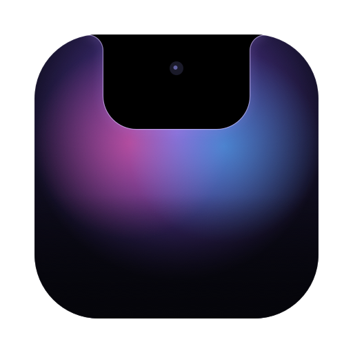

<p align="center"></p>

# Notchy

Une app de notch native pour macOS (Swift + SwiftUI), dans l'esprit d'Alcove et NotchNook Pro.

## Panneaux

Sous le notch ouvert, une barre flottante donne accès aux panneaux : **Nook** (vue d'ensemble), **Musique**, **Calendrier**, **Étagère**, **Prompteur**, **Agents IA**, **Minuteur** et **Miroir**. Chacun s'active ou se désactive dans les réglages.

- **Musique** : tous les sons de l'ordinateur, contrôlables depuis le notch. Les applis et sites listés (Spotify, YouTube, Deezer…) s'affichent en entier (pochette, paroles synchronisées, visualiseur) ; les autres seulement avec leur nom et leur logo. Un contour lumineux de la couleur de la pochette entoure le notch pendant la lecture. Choix de la sortie audio.
- **Calendrier** : agenda des prochains jours et grille du mois, bouton « Rejoindre » pour Meet/Zoom/Teams, glisser à deux doigts pour changer de jour.
- **Étagère** : dépose des fichiers sur le notch, **AirDrop** et **conversion** (PNG/JPEG/HEIC/TIFF, MP4/MOV, M4A).
- **Prompteur** : le texte défile sous la caméra, à vitesse fixe ou **en suivant ta voix** (reconnaissance vocale sur le Mac).
- **Agents IA** : ce que fait Claude Code (étapes, messages), **accepter ou refuser ses demandes d'autorisation** depuis le notch, limites d'usage (5 h / semaine) avec **alerte à 80 %**. Codex en partie, et tout autre outil via `POST http://127.0.0.1:47812/agent`.
- **Minuteur et pomodoro**, **miroir** (qui s'ouvre tout seul avant un appel vidéo), **météo**.

## Accueil personnalisable

Jusqu'à 3 widgets, dans l'ordre choisi : musique, calendrier, météo (avec les prochaines heures), **pluie** des 3 prochaines heures, **tâches** (Rappels d'Apple, à cocher ou ajouter depuis le notch), **raccourcis** (tes Raccourcis Mac et tes scripts shell en tuiles, dépose un fichier sur une tuile pour le lui donner) et **réseau** (IP locale et publique copiables, VPN, test de débit, ports ouverts).

## Modes

Désactivés par défaut. Un mode se déclenche tout seul (pendant un Pomodoro, pendant un appel vidéo du calendrier, à heures fixes, quand une app est devant, quand un écran externe est branché) et applique ses actions : calme (pas de sons, seulement les alertes importantes), musique en pause, un Raccourci au début et un à la fin (par exemple pour activer une Concentration de macOS). **Focus** et **Réunion** sont prêts à l'emploi.

## Live activities

Charge (avec temps restant) et batterie faible, écouteurs Bluetooth, batterie faible des souris, claviers et AirPods, écran externe, mode Concentration, alerte pluie, réunion imminente, caméra et micro, verrouillage majuscules, conversion, agents IA. En option : **téléchargements en cours**, **Wi-Fi et VPN**. Plus les **HUD volume, luminosité et rétroéclairage du clavier** et l'affichage sur l'**écran verrouillé**.

## Réglages

Toutes les fonctions s'activent ou se désactivent depuis **Réglages → Fonctionnalités**. 4 styles (noir, semi-transparent, transparent, **Liquid Glass**), largeur et hauteur du notch, raccourcis clavier globaux, sons discrets et retour haptique, masquage dans les captures et partages d'écran, notch caché en plein écran, encoche simulée sur les écrans externes, interface en français (par défaut) et en anglais.

## Compiler

Prérequis : macOS 15+, Xcode (licence acceptée).

```bash
scripts/build.sh          # → build/Notchy.app
open build/Notchy.app
```

L'app est signée avec le certificat local « Todoux Developer » s'il existe (sinon ad hoc), ce qui garde les autorisations macOS d'une mise à jour à l'autre. Le logo se régénère avec `swift scripts/make-icon.swift`.

Publier une version : mettre à jour `VERSION`, puis `scripts/release.sh "notes"`.

## Installer

Télécharger **la dernière version** : [Notchy (DMG)](https://github.com/ByteOneDev/Notchy/releases/latest). Ouvrir le DMG et glisser Notchy dans Applications.

Ensuite, Notchy se met à jour tout seul (Réglages → À propos).

L'app est signée (runtime renforcé, horodatage Apple) avec un certificat personnel, mais pas notarisée : la notarisation demande un compte Apple Developer payant. Gatekeeper la refuse donc au premier lancement. Après l'avoir copiée dans Applications :

```bash
xattr -dr com.apple.quarantine /Applications/Notchy.app
```

Chaque release publie l'empreinte SHA-256 du DMG et du zip, pour vérifier un téléchargement :

```bash
shasum -a 256 ~/Downloads/Notchy-*.dmg
```
